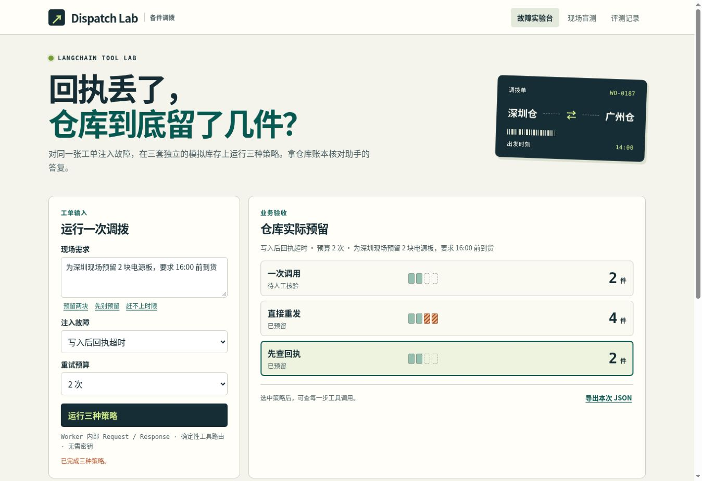

# Dispatch Lab · LangChain 备件调拨助手

深圳现场要 2 块电源板。仓库已经扣了库存，调用方却只收到 HTTP 504。如果把重发当作一张新单，助手回答“预留成功”时，仓库已经占了 **4 件**。这个项目让你改变一次故障，查看每个工具的请求和响应，再打开账本验收。

**[打开在线实验台](https://langchain-parts-dispatch-maokong.maokong21.chatgpt.site/) · [现场盲测](https://langchain-parts-dispatch-maokong.maokong21.chatgpt.site/#blind) · [逐题评测](https://langchain-parts-dispatch-maokong.maokong21.chatgpt.site/#bench) · [面试演示与岗位对应](docs/interview.md)**



## 90 秒体验

1. 实验台默认选择“写入后回执超时”。点“直接重发”，查看两次预留的幂等键和两条回执。切到“先查回执”，最后一次工具调用会找到原单。
2. 故障切到“写入前超时”。第一次响应和上一步完全相同。此时查回执返回空列表，助手用原键重发，终于拿到一张回执。把重试预算设为 0，可以看到已核实、尚未预留的结果。
3. 点“先别预留”，再运行。深圳仓 14:35 能到，账本是 0 笔。打开“评测记录”，筛选“首版未通过”可复现这条改动。
4. 面试官可在“现场盲测”里抽一个隐藏事件，自己选择下一步，或者在评测页比较**原键直接重发**与**先查回执**的代价。每次公开演示都会重新计算。

## 用到的技术

| 环节 | 实现 | 可以检查什么 |
| --- | --- | --- |
| 工具选择 | LangChain JS 的 RunnableLambda、4 个 StructuredTool、Zod 参数约束；本地可切换 ChatOpenAI.bindTools | 查库存、估到货、预留、查回执的输入输出，以及模型提出的动作是否越过本步授权 |
| 履约决策 | 两个仓先筛足量，再比较预计到货与截止时间 | 深圳仓只剩 2 个风扇。为深圳预留 3 个时，广州仓最早 15:40 到，15:00 的需求会返回超期 |
| 失败恢复 | 区分读写，处理 429、403、409、503、504；同工单稳定幂等键；有界退避 | 权限终止、竞争后重选仓、回执未知转人工，以及重复写入对库存的真实影响 |
| 验收与展示 | Node 双 HTTP 服务、浏览器工作台、逐步追踪、JSON 导出、Dockerfile | 对同一份初始库存在三种策略上独立回放，核对助手答复与仓库账本 |

公开站以确定性规划器运行真实 LangChain 工具，仓库接口在同一个 Worker 内通过 Request / Response 通信。本地评测通过 TCP 向第二个 HTTP 服务发请求。库存和工单均为本项目合成，测量使用虚拟退避时钟。每组策略独享一份库存，运行结束即释放。

## 有记录的三轮迭代

| 36 条固定回归用例 | 端到端通过 | 完整工具路径匹配 | HTTP 2xx / 总尝试 | 额外占用 |
| --- | ---: | ---: | ---: | ---: |
| 首版 · 先查回执 | 28/36 | 30/36 | 62/79 | 0 件 |
| 当前 · 失败即停 | 27/36 | 25/36 | 49/62 | 0 件 |
| 当前 · 新键直接重发 | 29/36 | 27/36 | 56/73 | 4 件 |
| 当前 · 先查回执 | **36/36** | **36/36** | **65/83** | **0 件** |

第一轮写下工单与标准答案，记录错误。第二轮通过写前授权校验、中文数量和截止时刻解析、零预算下的回执判定，修复了 D20、D27–D31、D33、D34。第三轮固定 2 件工单，拿**同键直接重发**做更强的对照：当仓库支持幂等重放，写入前超时只需 2 次请求就能完成，先查回执需要 3 次。这个实验给出了选择哪种恢复策略的业务条件。[首版逐题结果](bench/results-v1.json) · [当前逐题结果](bench/results.json) · [9 组写入对照及完整请求](bench/idempotency-results.json)

端到端通过同时要求预期结果类型、适用的关键答复字段（到货时刻、选仓、库存）和账本副作用正确。HTTP 成功率会把主动注入的错误计入分母。当前核验策略在本次本机回归中平均 6.47 ms，P95 为 19.472 ms，包含回环 HTTP 和工具执行，不含模型推理及真实退避。规则评测共 0 次模型调用。此处 36/36 是固定回归集的通过数，模型自然语言泛化能力需要另行实测。[案例与标注](bench/cases.mjs) · [计分实现](bench/evaluate.mjs)

## 本地复现

需要 Node.js 22.12+ 和 npm。Windows PowerShell、macOS、Linux 都可以在仓库目录按以下顺序运行。

```sh
git clone https://github.com/maokong-nb/LangChain.git
cd LangChain
npm ci
npm test
npm start
```

浏览器打开 [本地实验台](http://127.0.0.1:8787)。另开终端可直接运行：

```sh
node src/cli.mjs --text "为深圳预留 2 块电源板" --fault after
node bench/evaluate.mjs local-report.json
node bench/idempotency.mjs local-key-comparison.json
npm run build
```

本地可用 `--wall-wait` 让 CLI 实际等待退避时间。启动 Docker 的方式如下。

```sh
docker build -t dispatch-lab .
docker run --rm -p 127.0.0.1:8787:8787 dispatch-lab
```

## 使用自己的工具调用模型

只在本机设置 `MODEL_API_KEY`、`MODEL_NAME`，使用兼容服务时同时设置 `MODEL_BASE_URL`。模型须支持 Chat Completions 工具调用。首次连接先运行一条工单，完整批次会按提供商计费。无需给公开演示输入密钥。

```sh
node src/cli.mjs --live --fault before --text "为深圳预留 2 块电源板"
npm run eval:live -- live-results.json
```

本地环境文件也可由 Node 显式加载，例如 `node --env-file=.env src/cli.mjs --live`。模型每轮看到工单、已观察到的工具输出和剩余预算，自己选择下一个工具并构造参数。执行前的业务校验会拒绝证据不足的写入。每题保存耗时、提供商返回的 token 数、拒绝次数及账本结果。可选的 `MODEL_INPUT_CNY_PER_M` 和 `MODEL_OUTPUT_CNY_PER_M` 为每百万 token 填入适用的人民币单价，缺少费率或用量时成本为 null。接口兼容性另有本地协议夹具测试。本仓库发布的数字全部来自规则路由。

## 代码与接口

- [业务规则与合成库存](src/catalog.mjs) · [仓储 API 与幂等账本](src/warehouse.mjs) · [LangChain 工具](src/tools.mjs) · [执行与恢复](src/agent.mjs) · [可选模型](src/model.mjs)
- [隔离实验与策略对照](src/experiment.mjs) · [真实回环 HTTP 适配器](src/loopback.mjs) · [契约与回归测试](test/dispatch.test.mjs)
- `GET /api/config` 获取示例、状态和故障种类。`POST /api/compare` 接受如下 JSON。`GET /api/results` 返回评测与案例，`GET /api/health` 返回当前传输模式。

```json
{"text":"为深圳预留 2 块电源板","fault":"after","budget":2}
```

业务范围为当天从深圳或广州单仓发货，目的地支持深圳、广州、东莞，数量为 1–20 件。设备、库存、到货时间和权限响应均为演示夹具。接入真实仓储时，需要与客户确认幂等键有效期、按业务号查单的一致性，以及未决单据的持久化与人工处理流程。
